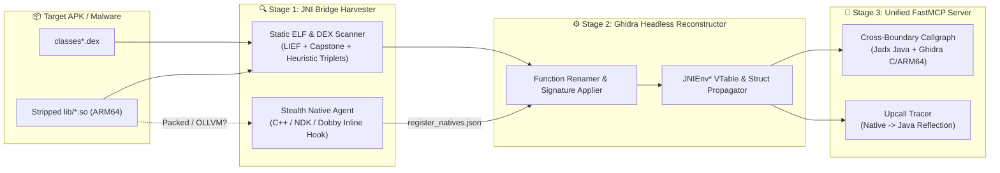

<div align="center">

# 🕵️‍♂️ JNISleuth-MCP

**Bridge the Java-to-Native Chasm in Android Reverse Engineering.**  
*Automated `RegisterNatives` Recovery, Stripped ARM64 `.so` Type Reconstruction, and a Unified Jadx + Ghidra MCP Server for AI-Assisted Malware Analysis.*

[](#)
[](#)
[](#)
[](#)
[](#)

[**Quickstart**](#-2-minute-quickstart) • [**How It Works**](#-architecture--how-it-works) • [**MCP Tools**](#-mcp-tools-for-ai-agents) • [**Stealth Dobby Agent**](#-stealth-dobby-agent-anti-rasp--packer-mode) • [**Roadmap**](#-roadmap)

</div>

---

## ⚡ Why JNISleuth-MCP?

Modern Android malware, banking trojans, spyware, and commercial packers hide their core logic (C2 encryption, key derivation, environment checks, and exploit routines) inside **stripped C/C++ native libraries (`lib*.so`)**.

When reversing across the JNI boundary, analysts hit three walls:
1. **Broken Cross-References:** `native` methods declared in `classes.dex` do not use standard `Java_com_pkg_Class_method` symbols. Instead, they are dynamically bound at runtime inside an obfuscated `JNI_OnLoad` via `JNIEnv->RegisterNatives()`.
2. **Blind Decompilation:** Opening a stripped `.so` in Ghidra or IDA shows thousands of unnamed `sub_XXXX` functions where `JNIEnv*` vtable calls look like raw pointer arithmetic (`(**(code **)(*param_1 + 0x538))(param_1, param_2)`).
3. **Disconnected AI Context:** Existing Ghidra MCP and Jadx MCP servers live in silos—an LLM cannot trace data flow from an Android `BroadcastReceiver` in Java straight into an ARM64 encryption routine in `libnative-lib.so`.

**`JNISleuth-MCP` eliminates the context switch.** It automatically recovers static and dynamic `RegisterNatives` bindings, re-types stripped ARM64 functions in Ghidra, and exposes a single unified **Model Context Protocol (MCP)** server connecting DEX bytecode to native assembly.

| Capability | Standard Jadx / Ghidra MCPs | `JNISleuth-MCP` |
| :--- | :---: | :---: |
| Resolve standard `Java_*` exports | ✅ | ✅ |
| Recover stripped `RegisterNatives` struct arrays statically (`.rodata` / `.data.rel.ro` + `JNI_OnLoad` CFG) | ❌ | ✅ |
| Stealth on-device `RegisterNatives` harvesting via **Dobby** (bypasses anti-Frida checks) | ❌ | ✅ |
| Auto-apply `JNIEnv*` vtable types & reconstruct `Call*Method` / `GetStringUTFChars` in Ghidra | ❌ | ✅ |
| Single-call cross-boundary dataflow (`Java Caller` ➔ `JNI Bridge` ➔ `Decompiled ARM64 C++`) | ❌ | ✅ |

---

## 🏗️ Architecture & How It Works



---

## 🎬 See It In Action

### 1. CLI Static + Dynamic `RegisterNatives` Recovery
Run `jnisleuth scan` against an APK with stripped native libraries:

```text
$ jnisleuth scan --apk samples/banker_dropper.apk --arch arm64-v8a

[*] Parsing 3 DEX files... Found 14 declared `native` methods across 4 classes.
[*] Inspecting lib/arm64-v8a/libcore-crypto.so (Stripped ELF, 0 exported Java_* symbols)
[*] Running static JNINativeMethod triplet scanner on .rodata / .data.rel.ro...
    [+] Resolved 11/14 methods via static struct table @ 0x0004d210
[!] 3 methods unresolved (constructed dynamically on stack in JNI_OnLoad).
[*] Launching headless Dobby collector on device (emulator-5554)...

┏━━━━━━━━━━━━━━━━━━━━━━━━━━━━━━━━━━━━━━━━━━┳━━━━━━━━━━━━━━━━━━━━━━┳━━━━━━━━━━━━━━━━━━━━━┳━━━━━━━━━━━━━━━━━━┓
┃ Java Class & Method                      ┃ JNI Signature        ┃ .so Offset (ARM64)  ┃ Resolution Mode  ┃
┡━━━━━━━━━━━━━━━━━━━━━━━━━━━━━━━━━━━━━━━━━━╇━━━━━━━━━━━━━━━━━━━━━━╇━━━━━━━━━━━━━━━━━━━━━╇━━━━━━━━━━━━━━━━━━┩
│ com.dropper.Core#initEngine              │ (Landroid/content/.. │ libcore.so+0x001a40 │ Static (.rodata) │
│ com.dropper.Core#decryptPayload          │ ([BLjava/lang/Stri.. │ libcore.so+0x0023c8 │ Static (.rodata) │
│ com.dropper.Core#signC2Beacon            │ (Ljava/lang/String.. │ libcore.so+0x003f10 │ Dynamic (Dobby)  │
│ com.dropper.net.SocketBridge#connectRaw  │ (Ljava/lang/String.. │ libcore.so+0x004890 │ Dynamic (Dobby)  │
└──────────────────────────────────────────┴──────────────────────┴─────────────────────┴──────────────────┘
[+] Synced 14 function signatures and JNIEnv* types to Ghidra project: banker_dropper.gpr
```

### 2. Before vs. After in Ghidra

**Before `JNISleuth-MCP` (`FUN_000123c8`):**
```c
long FUN_000123c8(long *param_1, undefined8 param_2, undefined8 param_3, undefined8 param_4) {
  char *pcVar1;
  long lVar2;
  pcVar1 = (char *)(**(code **)(*param_1 + 0x548))(param_1, param_4, 0);
  lVar2 = (**(code **)(*param_1 + 0x5c0))(param_1, param_3, 0);
  sub_00014a00(lVar2, pcVar1);
  (**(code **)(*param_1 + 0x550))(param_1, param_4, pcVar1);
  return param_3;
}
```

**After `JNISleuth-MCP` (`Java_com_dropper_Core_decryptPayload`):**
```c
jbyteArray Java_com_dropper_Core_decryptPayload(
    JNIEnv *env, jobject thiz, jbyteArray encryptedData, jstring rc4KeyStr) 
{
  const char *key_utf = (*env)->GetStringUTFChars(env, rc4KeyStr, NULL);
  jbyte *payload_bytes = (*env)->GetByteArrayElements(env, encryptedData, NULL);
  rc4_crypt_buffer(payload_bytes, key_utf);
  (*env)->ReleaseStringUTFChars(env, rc4KeyStr, key_utf);
  return encryptedData;
}
```

---

## 🤖 MCP Tools for AI Agents

Connect `JNISleuth-MCP` to **Claude Desktop**, **Cursor**, **Gemini CLI**, or **Cline** to give your LLM full visibility across the Java/Native boundary:

| MCP Tool Name | Description |
| :--- | :--- |
| `resolve_apk_jni_map(apk_path)` | Extracts all `native` declarations from DEX and maps them to exact ELF file offsets in `lib/*.so` (via export symbols, static `.rodata` triplets, or dynamic trace import). |
| `get_cross_boundary_slice(java_method)` | Returns the decompiled Java caller (via Jadx) **and** the typed, decompiled C/ARM64 implementation (via Ghidra) in a single unified response. |
| `trace_jni_upcalls(so_name, fn_offset)` | Lists every Java reflection callback (`FindClass`, `GetMethodID`, `CallObjectMethod`, `SetByteArrayRegion`) invoked inside a native ARM64 function and its callees. |
| `sync_ghidra_jni_types(trace_json)` | Applies `JNIEnv*`, `JavaVM*`, `JNINativeMethod` structs, and recovered function signatures directly into an active or headless Ghidra project. |
| `sync_ida_jni_types(trace_json)` | Applies `JNIEnv*`, `JavaVM*`, `JNINativeMethod` C headers, recovered function prototypes, and OLLVM `fl_JN` code cross-references into IDA Pro 9.0 (`idalib` / `idapyswitch` / `idat64`). |
| `resolve_ollvm_indirect_branches(so_name, fn_offset)` | Resolves OLLVM `CSEL` + `BR X8` state-machine dispatchers and `.rodata` jump tables in `JNI_OnLoad`, and optionally patches the ELF binary with direct `B.<cond>` / `B` instructions. |
| `extract_jni_onload_strings(so_name)` | Dumps stack-constructed and XOR-decrypted strings inside `.init_array` and `JNI_OnLoad`. |

---

## 🥷 Stealth Dobby Agent (Anti-RASP & Packer Mode)

Many wild Android malware families and commercial protectors immediately crash or exit if they detect `frida-agent.so` in `/proc/self/maps`, `gum-js-loop` threads, or modified function prologues in `libc.so`.

`JNISleuth-MCP` includes an optional **zero-Frida native collector (`agent-native/`)** written in C++20 and ARM64 assembly using **Dobby**:
* **Mid-Function Hooking:** Places hooks inside the `ArtMethod::RegisterNative` / `JNIEnvExt::RegisterNatives` dispatch path rather than the first instruction of exported stubs, evading basic prologue integrity scanners.
* **Base-Address Normalization:** Uses `dladdr()` and linker `soinfo` traversal to automatically subtract ASLR slide and record deterministic file offsets (`libfoo.so + 0x23c8`), even if the packer unmaps ELF section headers after `JNI_OnLoad`.

---

## 🚀 2-Minute Quickstart

### Prerequisites
* Python 3.10+ (`pip install uv`)
* Ghidra 11.0+ (`GHIDRA_INSTALL_DIR`) or IDA Pro 9.0+ (`IDA_INSTALL_DIR` / `idapyswitch`)
* Jadx CLI installed in `$PATH`
* *(Optional)* Android NDK r26+ & ADB for dynamic Dobby collection

### Installation
```bash
git clone https://github.com/<your-username>/JNISleuth-MCP.git
cd JNISleuth-MCP
uv sync

# 1. Scan the included obfuscated NDK crackme sample & sync with Ghidra / IDA Pro 9.0:
uv run jnisleuth scan --apk examples/obfuscated_jni_sample.apk --ghidra-headless --ida-headless

# 2. Resolve & patch OLLVM CSEL + BR X8 indirect branches in JNI_OnLoad:
uv run jnisleuth deobfuscate --so examples/libcore-crypto.so --offset 0x5200 --patch-out examples/libcore-crypto.deobf.so
```

### Add to Claude Desktop / Cursor (`mcp.json`)
```json
{
  "mcpServers": {
    "jnisleuth-mcp": {
      "command": "uv",
      "args": ["run", "--directory", "/path/to/JNISleuth-MCP", "jnisleuth-mcp"],
      "env": {
        "GHIDRA_INSTALL_DIR": "/opt/ghidra"
      }
    }
  }
}
```

---

## 🗺️ Roadmap

- [x] Static DEX `native` method parser + ELF `.rodata` / `.data.rel.ro` `JNINativeMethod` triplet scanner
- [x] Headless Ghidra `JNIEnv*` vtable auto-typing script for ARM64 & x86_64
- [x] Unified FastMCP server bridging Jadx, Ghidra & IDA Pro 9.0
- [x] On-device Dobby mid-function `RegisterNatives` + `DexFile::OpenCommon` unpacker module
- [x] IDA Pro 9.0 (`idapyswitch` / `idalib` / headless `idat64`) backend support alongside Ghidra
- [x] Automated OLLVM indirect-branch (`BR X8`) resolver & ELF patcher for `JNI_OnLoad` state machines

---

## ⚠️ Disclaimer

`JNISleuth-MCP` is developed for **defensive malware analysis, mobile application security assessments, and reverse-engineering research**. All sample binaries in `examples/` are synthetic crackmes created specifically for testing.
